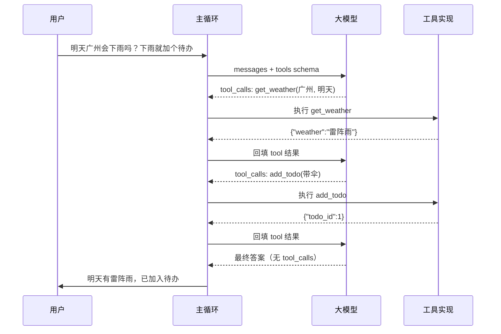

# 工具调用型个人助理 Agent

用自然语言提需求，Agent 自己决定调哪个工具、传什么参数、要不要再调一次，最后汇总成一句人话。

从零手写的 Function Calling / ReAct 循环，**不依赖 LangChain**。核心代码不到 300 行，
目的是把"模型怎么调度工具"这件事拆开看清楚——出问题能定位到具体环节，而不是对着一行 `agent.run()` 猜。

---

## 为什么不用现成框架

用 LangChain 三行就能跑起来，但说不清"模型为什么会选错工具""为什么有时候不调工具直接编答案"。
所以手写一遍：把**工具注册、参数生成、结果回填、轮数控制**分别暴露出来。

## 它能做什么

| 工具 | 说明 |
|---|---|
| `get_weather(city, date)` | 查指定城市指定日期的天气（默认返回确定性演示数据，接真实 API 只需改 `_fetch()`） |
| `add_todo(content, due)` | 新增待办，返回编号，落盘到 `storage/todos.json` |
| `list_todos(include_done)` | 列出待办 |
| `summarize_text(text, max_len)` | 文本摘要（配了 Key 走模型，没配则按句截断） |

不联网也能看循环怎么跑：

```bash
python main.py --demo
```

```
[step 1] 需要先查天气 -> get_weather -> {'city': '广州', 'date': '2026-11-17', 'weather': '雷阵雨', 'temp': '22~27℃'}
[step 2] 有雨，加个待办 -> add_todo -> {'todo_id': 1, 'status': 'created', 'content': '带伞'}

（演示模式）已查询明天广州天气，并把「带伞」加入待办。接真实模型后这里会是自然语言总结。
```

> `--demo` 用脚本模拟模型（`ScriptedClient`），只为展示循环结构，不代表真实模型行为。

## 技术栈

- Python 3.10+
- 大模型：任意 OpenAI 兼容接口（`function calling` 模式）
- 依赖：`openai`、`rich`（终端着色，可选）、`python-dotenv`
- 无数据库、无框架，待办存 JSON

## 执行流程



## 核心实现

**1. 工具注册表：新增工具只写一个函数**

```python
@tool(
    name="get_weather",
    description="查询指定城市在指定日期的天气。日期支持「今天/明天/后天」或 YYYY-MM-DD。",
    schema={
        "type": "object",
        "properties": {
            "city": {"type": "string", "description": "城市名，如 广州"},
            "date": {"type": "string", "description": "今天 / 明天 / 后天，或 YYYY-MM-DD"},
        },
        "required": ["city"],
    },
    group="daily",
)
def get_weather(city: str, date: str | None = None) -> dict: ...
```

装饰器把函数注册进 `TOOL_REGISTRY`，并统一生成模型需要的 `tools` 数组。
**模型看不到实现，只看 name + description + schema**——这三样写得清不清楚，直接决定它会不会选错。

**2. 主循环：三步收敛**

```python
for i in range(1, max_steps + 1):
    reply = client.create(messages, tools)
    messages.append(_assistant_message(reply))

    if not reply.tool_calls:          # 没有工具调用 = 模型认为可以回答了
        return RunResult(answer=reply.content, steps=steps)

    for call in reply.tool_calls:     # 逐个执行并回填
        observation = executor.safe_execute(call.name, call.arguments)
        messages.append({"role": "tool", "tool_call_id": call.id,
                         "content": json.dumps(observation, ensure_ascii=False)})
```

**3. 稳定性：三个必须有保护的地方**

| 保护 | 做法 | 不加会怎样 |
|---|---|---|
| 死循环 | `MAX_STEPS` 默认 6，超出返回中间结果 | 模型反复调同一个工具，请求不返回 |
| 工具报错 | `safe_execute` 捕获异常，以 `{"error": ...}` 回填 | 一次超时整个对话崩掉 |
| 参数幻觉 | 按 JSON Schema 校验入参，不合法就把错误回填让模型重试 | 模型传 `date="下周"`，工具直接抛异常 |

核心在**错误也是 observation**：把异常信息交给模型，它通常能自己修正参数再试一次。
`tests/test_registry.py::test_error_is_returned_not_raised` 就是这个行为的回归测试。

**4. 可观测**：`--verbose` 打印每轮的 thought / action / observation。调试工具调用最怕黑盒，
能一眼看出是在哪一步跑偏——选错工具、参数不对、还是该停没停。

## 快速开始

```bash
git clone git@github.com:Castoricef/agent-tool-demo.git
cd agent-tool-demo
python -m venv .venv && source .venv/bin/activate   # Windows: .venv\Scripts\activate
pip install -r requirements.txt

python main.py --demo          # 不联网，看循环怎么跑
cp .env.example .env           # 填 OPENAI_API_KEY / OPENAI_BASE_URL / MODEL
python main.py "明天广州会下雨吗？下雨就加个待办"
python main.py --verbose "..." # 看每轮调度轨迹
python main.py                 # 交互模式
```

跑测试：

```bash
python -m unittest discover -s tests -t . -v
```

## 目录结构

```
.
├── main.py                 # 入口：单次 / 交互 / demo
├── agent/
│   ├── registry.py         # @tool 装饰器与注册表，生成 tools schema
│   ├── executor.py         # JSON 校验、参数类型校验、异常兜底
│   └── loop.py             # ReAct 主循环、轮数控制、客户端封装
├── tools/
│   ├── weather.py          # 演示数据，接真实 API 改 _fetch()
│   ├── todo.py             # 待办增查，落盘 JSON
│   └── summarize.py        # 摘要，无 Key 时按句截断
├── storage/                # 待办持久化（.gitignore）
└── tests/test_registry.py  # 14 个单测：注册、校验、兜底、待办
```

## 踩坑记录

- **参数名会遮蔽标准库**。`get_weather(city, date)` 里 `date` 挡住了 `datetime.date`，调用 `date.fromisoformat` 直接报错。单测发现的，改成 `from datetime import date as Date` 才对。
- **工具描述含糊，模型就会滥用**。最早 `summarize_text` 的描述是"处理文本"，模型拿它去改写待办内容。改成"把长文本压缩为不超过 max_len 字的摘要，不要用它改写或扩写"后不再误用。
- **工具不是越多越好**。从 4 个加到 9 个后选错概率明显上升，所以加了 `group` 分组，按场景只加载需要的。
- **超时要设在请求层，不是工具内部**。工具里有网络请求时，超时卡在工具里会拖死整轮循环。
- **多工具并行调用要注意 `tool_call_id` 一一对应**，否则模型会串结果。

## 已知问题 / TODO

- [ ] 写操作（增删待办）前加人工确认
- [ ] 把 trace 存成 JSONL，便于复盘失败案例
- [ ] 工具结果加缓存，同参数短时间不重复调
- [ ] 换成 LangGraph 重写一遍，对比手写版在复杂流程下的差异
- [ ] 并行执行多个 tool_calls（目前是顺序执行）

## License

MIT
